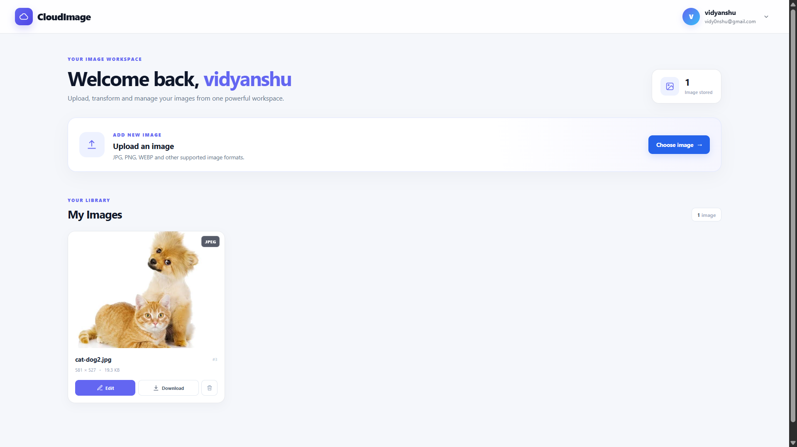
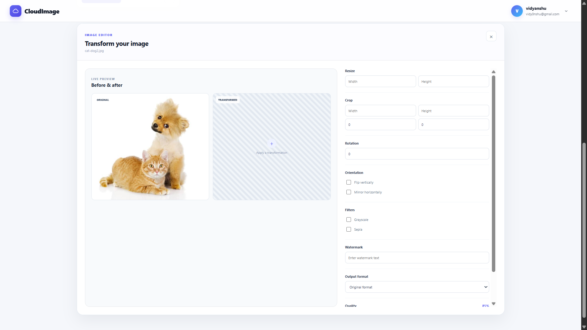
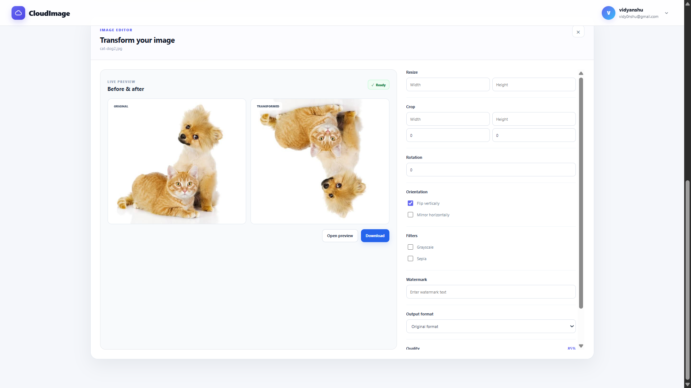

# ☁️ CloudImage — Cloud Image Processing Service

A full-stack, cloud-based image processing platform built with **FastAPI, React, PostgreSQL, Backblaze B2, JWT authentication, Pillow, SQLAlchemy, and Alembic**.

CloudImage allows authenticated users to upload images, securely store them in private object storage, perform image transformations, preview and download transformed files through temporary presigned URLs, and manage their image library through a responsive web dashboard and REST API.

## 🚀 Live Deployment

| Resource | Link |
|---|---|
| **Live Application** | https://cloud-image-processor-nine.vercel.app |
| Backend API | https://cloudimage-api-latest.onrender.com |
| Swagger Documentation | https://cloudimage-api-latest.onrender.com/docs |
| API Health | https://cloudimage-api-latest.onrender.com/api/v1/health |
| Database Health | https://cloudimage-api-latest.onrender.com/api/v1/health/db |
| GitHub Repository | https://github.com/vidyanshu01/cloud-image-processor |

> **Note:** The backend runs on Render and may take some time to respond after inactivity.

## 🖥️ Screenshots

### Dashboard



### Image Editor



### Transformed Image Preview



> Add the screenshots to `docs/assets/`. Use screenshots from the working production application.

---

## ✨ Features

### 🔐 Authentication & Security

- User registration and login
- JWT-based authentication
- Argon2 password hashing
- Protected image APIs
- User-specific resource authorization
- Private Backblaze B2 bucket
- Temporary presigned URLs
- File size validation
- MIME type validation
- Image integrity validation
- Image dimension limits
- Maximum pixel-count protection
- Environment-based configuration
- Sensitive credentials excluded from Git

### 🖼️ Image Management

- Upload images
- Retrieve image metadata
- List user images
- Pagination
- Search by filename
- Filter by image format
- Sort by newest, oldest, largest, and smallest
- Generate secure image access URLs
- Download images
- Delete images
- Delete associated transformations

### 🎨 Image Transformations

Supported transformations include:

- Resize
- Crop
- Rotate
- Flip
- Mirror
- Grayscale
- Sepia
- Watermark
- Format conversion
- Quality control

Supported formats:

- JPEG
- PNG
- WebP
- GIF

### ⚡ Transformation Caching

CloudImage generates a deterministic transformation hash using **SHA3-256**.

When an identical transformation is requested again, the application checks the database for an existing result and reuses it.

```text
User Request
     |
     v
Transformation Hash
     |
     v
Database Cache Lookup
     |
     +---- Cache Hit ----> Return Existing Result
     |
     +---- Cache Miss
                 |
                 v
          Process Image
                 |
                 v
          Upload to B2
                 |
                 v
          Save Metadata
                 |
                 v
          Return Result
```

This reduces unnecessary image processing and duplicate object uploads.

### ☁️ Backblaze B2 Object Storage

Images are stored in a private Backblaze B2 bucket through its S3-compatible API.

Storage structure:

```text
users/
├── {user_id}/
│   ├── images/
│   │   ├── <uuid>.jpg
│   │   ├── <uuid>.png
│   │   └── ...
│   │
│   └── transformations/
│       ├── <uuid>.jpg
│       ├── <uuid>.webp
│       └── ...
```

The application does not expose the storage bucket publicly.

Instead, FastAPI generates temporary presigned URLs:

```text
Private B2 Object
       |
       v
    FastAPI
       |
       v
  Presigned URL
       |
       v
     Client
```

---

## 🏗️ System Architecture

```text
              +----------------------+
              |       Client         |
              |    React + Vite      |
              +----------+-----------+
                         |
                         | HTTPS / REST API
                         v
              +----------------------+
              |       FastAPI        |
              |      API Layer       |
              +----------+-----------+
                         |
          +--------------+--------------+
          |              |              |
          v              v              v
     +---------+    +---------+    +-------------+
     |  Auth   |    |  Image  |    |Transformation|
     | Service |    | Service |    |   Service   |
     +----+----+    +----+----+    +------+------+
          |              |                |
          +--------------+----------------+
                         |
                         v
              +----------------------+
              |      PostgreSQL      |
              | Users / Images /     |
              | Transformations     |
              +----------+-----------+
                         |
                         v
              +----------------------+
              |    Backblaze B2      |
              |   Private Objects    |
              +----------------------+
```

## 🧰 Technology Stack

| Category | Technology |
|---|---|
| Frontend | React |
| Frontend Build Tool | Vite |
| API Framework | FastAPI |
| Language | Python |
| Validation | Pydantic |
| Database | PostgreSQL |
| ORM | SQLAlchemy |
| Database Migrations | Alembic |
| Image Processing | Pillow |
| Object Storage | Backblaze B2 |
| Storage SDK | Boto3 |
| Authentication | JWT |
| Password Hashing | Argon2 |
| Configuration | Pydantic Settings |
| API Documentation | Swagger / OpenAPI |
| Testing | Pytest |
| Containerization | Docker |
| Orchestration | Docker Compose |
| CI/CD | GitHub Actions |
| Frontend Deployment | Vercel |
| Backend Deployment | Render |
| Version Control | Git / GitHub |

---

## 📁 Project Structure

```text
cloud-image-processor/
│
├── backend/
│   ├── alembic/
│   │   └── versions/
│   │
│   ├── app/
│   │   ├── api/
│   │   ├── core/
│   │   ├── models/
│   │   ├── schemas/
│   │   ├── services/
│   │   ├── storage/
│   │   ├── utils/
│   │   └── main.py
│   │
│   ├── tests/
│   ├── Dockerfile
│   ├── Dockerfile.test
│   ├── alembic.ini
│   └── requirements.txt
│
├── frontend/
│   ├── src/
│   ├── public/
│   ├── package.json
│   └── vite.config.js
│
├── .github/
│   └── workflows/
│       ├── ci.yml
│       └── integration.yml
│
├── docs/
│   └── assets/
│
├── docker-compose.yml
├── docker-compose.test.yml
├── .dockerignore
├── .env.example
├── .gitignore
└── README.md
```

---

## 🔄 Image Upload Pipeline

```text
Client
  |
  | Upload Image
  v
FastAPI
  |
  +-- File Size Validation
  |
  +-- MIME Type Validation
  |
  +-- Pillow Image Validation
  |
  +-- Dimension Validation
  |
  +-- Pixel Count Validation
  |
  v
Temporary File
  |
  v
Backblaze B2
  |
  v
PostgreSQL
  |
  v
API Response
```

## 🎨 Transformation Pipeline

```text
Original Image
      |
      v
Transformation Request
      |
      v
Generate SHA3-256 Hash
      |
      v
Check Database Cache
      |
      +---- Hit ----> Return Existing Result
      |
      +---- Miss
               |
               v
         Download from B2
               |
               v
      Apply Transformations
               |
               v
         Encode Output
               |
               v
         Upload to B2
               |
               v
        Save Metadata
               |
               v
         Return Result
```

---

## 🗄️ Database Design

### Users

```text
users
├── id
├── username
├── email
├── password_hash
└── created_at
```

### Images

```text
images
├── id
├── user_id
├── original_filename
├── storage_key
├── mime_type
├── format
├── width
├── height
├── file_size
├── created_at
└── updated_at
```

### Image Transformations

```text
image_transformations
├── id
├── image_id
├── user_id
├── transformation_hash
├── storage_key
├── format
├── mime_type
├── width
├── height
├── file_size
└── created_at
```

Relationships:

```text
User
 |
 +---- Images
          |
          +---- Transformations
```

---

## 🔐 Authentication

CloudImage uses JWT Bearer authentication.

Registration:

```text
User Registration
       |
       v
Argon2 Password Hash
       |
       v
PostgreSQL
```

Login:

```text
Username + Password
       |
       v
Verify Argon2 Hash
       |
       v
Generate JWT
       |
       v
Client
```

Protected requests:

```http
Authorization: Bearer <access_token>
```

JWT expiration is configurable through environment variables.

## 🛡️ Image Validation

Before an image is stored, CloudImage validates:

| Validation | Limit / Supported Values |
|---|---|
| Maximum file size | 10 MB |
| JPEG | Supported |
| PNG | Supported |
| WebP | Supported |
| GIF | Supported |
| Maximum dimensions | 10000 × 10000 |
| Maximum pixel count | 50,000,000 pixels |
| Image integrity | Pillow verification |

These checks provide multiple layers of protection rather than trusting only the uploaded filename or MIME type.

---

## 🌐 API Endpoints

Base URL:

```text
/api/v1
```

### Health

| Method | Endpoint | Description |
|---|---|---|
| GET | `/health` | Application health |
| GET | `/health/db` | Database health |

### Authentication

| Method | Endpoint | Description |
|---|---|---|
| POST | `/auth/register` | Register user |
| POST | `/auth/login` | Login |
| GET | `/auth/me` | Current user |

### Images

| Method | Endpoint | Description |
|---|---|---|
| POST | `/images` | Upload image |
| GET | `/images` | List images |
| GET | `/images/{image_id}` | Get image metadata |
| GET | `/images/{image_id}/file` | Generate original file URL |
| GET | `/images/{image_id}/download` | Generate download URL |
| POST | `/images/{image_id}/transform` | Transform image |
| DELETE | `/images/{image_id}` | Delete image |

### Transformations

| Method | Endpoint | Description |
|---|---|---|
| GET | `/images/transformations/{transformation_id}/file` | Generate transformed image URL |

For complete request and response schemas, visit the live [Swagger documentation](https://cloudimage-api-latest.onrender.com/docs).

---

## 🧪 Testing & CI/CD

The backend includes automated regression and storage integration tests using Pytest.

Test coverage includes:

- Application and database health
- User registration and login
- Authentication and authorization
- Image upload and validation
- Image metadata and pagination
- Search, filtering, and sorting
- Image transformations
- Transformation caching
- Original and transformed file URLs
- Storage upload, download, and deletion
- Presigned URL generation
- Cross-user access protection

### GitHub Actions

Automated workflows are configured for:

- Backend CI testing
- Docker image build
- Backblaze B2 storage integration testing

The B2 integration workflow verifies communication with actual object storage using GitHub Actions secrets.

Run backend tests locally:

```bash
cd backend
python -m pytest -v
```

Run Docker integration tests from the repository root:

```bash
docker compose -f docker-compose.test.yml up --build --abort-on-container-exit --exit-code-from api-test
```

---

## 🐳 Docker Setup

Build and start the application:

```bash
docker compose up --build -d
```

Check running containers:

```bash
docker compose ps
```

View logs:

```bash
docker compose logs -f
```

Stop services:

```bash
docker compose down
```

Configure the required environment variables before starting the application.

---

## ⚙️ Local Development Setup

### 1. Clone Repository

```bash
git clone https://github.com/vidyanshu01/cloud-image-processor.git
cd cloud-image-processor
```

### 2. Configure Environment

Use `.env.example` as the template and create a local `.env` file.

Never commit actual credentials.

### 3. Backend Setup

```bash
cd backend

python -m venv .venv
```

Windows:

```powershell
.venv\Scripts\Activate.ps1
```

Linux/macOS:

```bash
source .venv/bin/activate
```

Install dependencies:

```bash
pip install -r requirements.txt
```

Run database migrations:

```bash
python -m alembic upgrade head
```

Start FastAPI:

```bash
uvicorn app.main:app --reload
```

### 4. Frontend Setup

Open another terminal:

```bash
cd frontend
npm install
npm run dev
```

The Vite development server will display its local URL in the terminal.

### 5. API Documentation

Swagger UI:

```text
http://127.0.0.1:8000/docs
```

ReDoc:

```text
http://127.0.0.1:8000/redoc
```

---

## 🔧 Environment Configuration

Configure the following variables using `.env.example`:

```env
APP_NAME=Cloud Image Processing Service
APP_VERSION=1.0.0
DEBUG=True

DATABASE_URL=YOUR_DATABASE_URL

JWT_SECRET_KEY=YOUR_SECRET_KEY
JWT_ALGORITHM=HS256
ACCESS_TOKEN_EXPIRE_MINUTES=30

MAX_FILE_SIZE_MB=10

AWS_ACCESS_KEY_ID=YOUR_B2_KEY_ID
AWS_SECRET_ACCESS_KEY=YOUR_B2_APPLICATION_KEY
AWS_REGION=YOUR_B2_REGION
AWS_S3_BUCKET_NAME=YOUR_BUCKET_NAME
AWS_S3_ENDPOINT_URL=YOUR_B2_ENDPOINT
```

The application uses Boto3's S3-compatible interface to communicate with Backblaze B2.

> Never commit `.env`, JWT secrets, database passwords, or B2 application keys to GitHub.

---

## 📊 API Response Strategy

File endpoints return JSON rather than redirecting directly to object storage.

Example:

```json
{
  "url": "temporary-presigned-url",
  "mime_type": "image/png",
  "expires_in": 3600
}
```

This keeps API behavior predictable for frontend clients and Swagger/OpenAPI testing.

## 📝 Logging

Application logging is implemented using Python's standard logging framework.

Log format:

```text
timestamp | logger | filename | level | message
```

Sensitive information such as passwords, JWT tokens, storage credentials, and presigned URLs should not be logged.

## 🔄 Database Migrations

Alembic manages database schema changes.

Create migration:

```bash
alembic revision --autogenerate -m "description"
```

Apply migrations:

```bash
alembic upgrade head
```

Rollback:

```bash
alembic downgrade -1
```

Check schema differences:

```bash
alembic check
```

---

## 🧠 Engineering Highlights

This project demonstrates practical software engineering and cloud development concepts.

### API Architecture

```text
Router
  |
  v
Service
  |
  v
Database / Storage
```

Business logic is separated from API routing.

### Separation of Concerns

- API layer handles HTTP requests and responses.
- Service layer handles application logic.
- Database layer manages persistent metadata.
- Storage layer manages object storage operations.

### Cloud Object Storage

Binary image files are stored in Backblaze B2, while PostgreSQL stores searchable metadata.

### Deterministic Caching

Identical transformation requests can reuse previously generated results using SHA3-256 hashes.

### Failure Cleanup

Storage and database operations include cleanup handling to reduce orphaned objects when operations fail.

### Security

JWT authentication, Argon2 password hashing, ownership checks, private object storage, and image validation protect application resources.

---

## 📈 Version History

```text
v0.1.0  Project foundation
v0.2.0  Authentication and user management
v0.3.0  Image upload and validation
v0.4.0  Object storage integration
v0.5.0  Image transformation pipeline
v0.6.0  Image management and transformation caching
v0.7.0  API regression and security validation
v1.0.0  Full-stack deployment and cloud storage integration
```

## 🛣️ Future Improvements

- [ ] API rate limiting
- [ ] Redis caching
- [ ] Background image processing
- [ ] Celery task queue
- [ ] Image optimization pipeline
- [ ] Monitoring and metrics
- [ ] Production observability
- [ ] Advanced image editing features

---

## 👨‍💻 Author

**Vidyanshu Kushwaha**

B.Tech — Computer Science and Engineering, Data Science

GitHub: [vidyanshu01](https://github.com/vidyanshu01)

Interested in:

- AI / Machine Learning Engineering
- Python Backend Development
- Generative AI
- Cloud Engineering
- MLOps

---

## ⭐ Support

If you find this project useful, consider giving the repository a ⭐ on GitHub.

## 📄 License

This project is intended for educational, portfolio, and development purposes.
